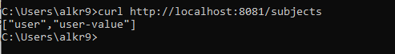
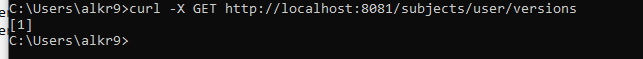
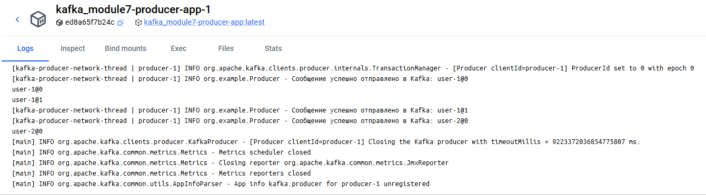
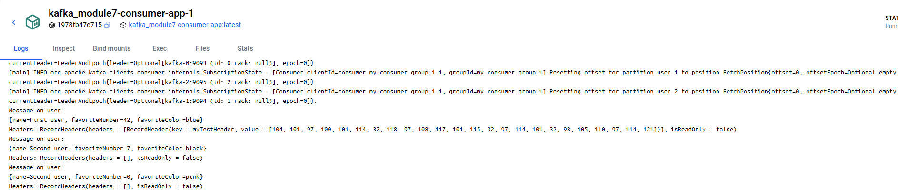
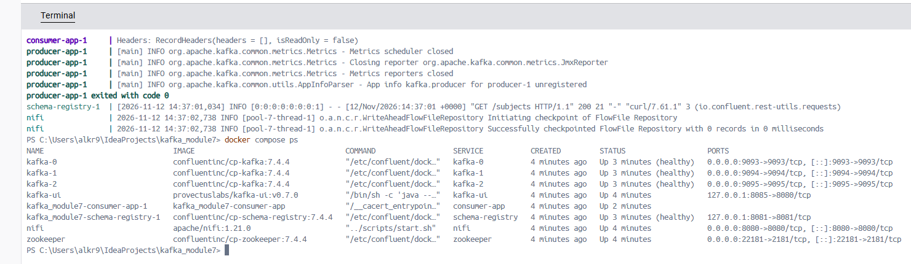
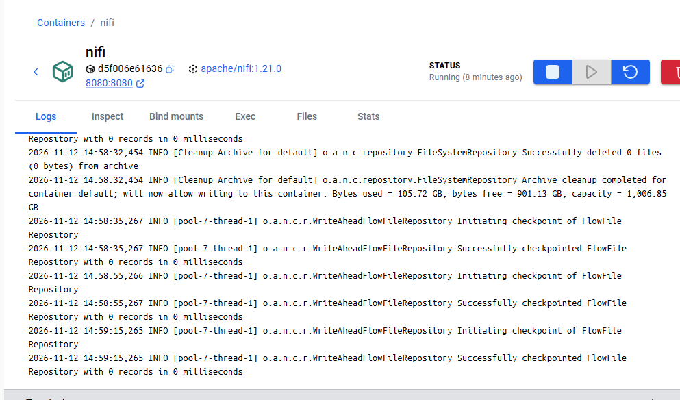
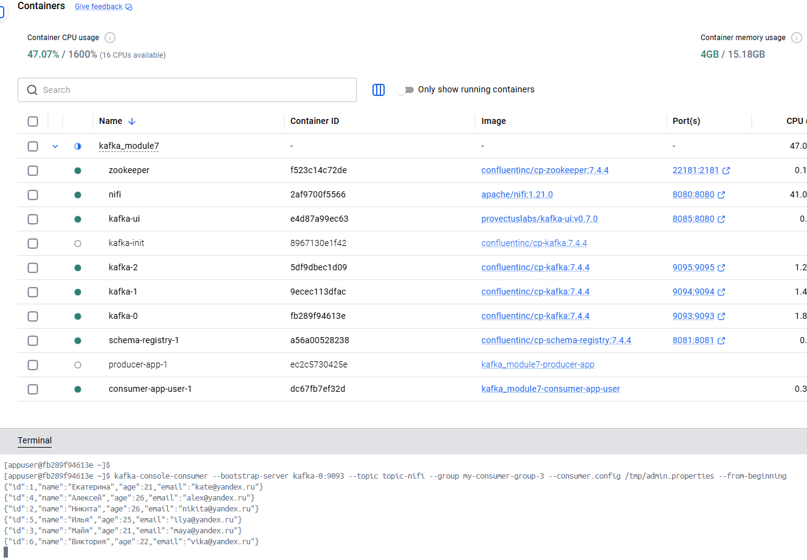

# Kafka-кластер (3 брокера) + Schema Registry + интеграция с Apache NiFi

Учебный проект модуля 7. Кластер развёрнут **локально в Docker** (развертывание в Yandex Cloud заменено локальным).

Все артефакты задания собраны в репозитории: скриншоты — `screenshots/`, схема данных — `user_scheme.json`, скрипты конфигурации — `init/init-cluster.sh` и `docker-compose.yaml`, код продюсера/консьюмеров — `src/main/java/org/example/`.

---

## 1. Краткое описание выполненных шагов

**Задание 1 — развёртывание и настройка Kafka-кластера:**

1. Развёрнут кластер из **3 брокеров** (`kafka-0`, `kafka-1`, `kafka-2`; confluentinc/cp-kafka:7.4.4 = Apache Kafka 3.4.x) + ZooKeeper — `docker-compose.yaml`.
2. Выполнена настройк: шифрование и аутентификация **SASL_SSL** (TLS + SASL/PLAIN), авторизация через **ACL**, отключено автосоздание топиков (`KAFKA_AUTO_CREATE_TOPICS_ENABLE=false`), настроены healthchecks всех компонентов.
3. Созданы топики `user` и `topic-nifi`: **3 партиции, коэффициент репликации 3** (все брокеры кластера) — `init/init-cluster.sh`.
4. Для топика `user` настроены параметры хранения: `cleanup.policy=delete`, `retention.ms=300000`, `segment.bytes=2000` (топик-уровневые аналоги broker-параметров).
5. Развёрнут **Schema Registry** (confluentinc/cp-schema-registry:7.4.4, `http://localhost:8081`), схема `User` зарегистрирована двумя способами: вручную из кода (`SchemaRegistryHelper`, subject `user`) и автоматически сериализатором (`auto.register.schemas=true`, subject `user-value`).
6. Написаны продюсер и консьюмер: отправлены тестовые сообщения (3 объекта `User`), чтение подтверждено логами консьюмера.

**Задание 2 — интеграция с внешней системой (Apache NiFi):**

7. Развёрнут **Apache NiFi 1.21.0** (`http://localhost:8080/nifi/`).
8. Настроен поток **GetFile → PublishKafkaRecord_2_0**: CSV-файлы из папки `nifi_data/` публикуются в топик `topic-nifi` (конфигурация потока — `nifi_template.xml`).
9. Передача данных подтверждена: вывод `kafka-console-consumer.sh` по `topic-nifi` и логи NiFi.

---

## 2.  Ресурсы в этой локальной Docker-развертке

| Сервис | CPU (cpus) | RAM (mem_limit) | Куча JVM | Диски |
|---|---|---|---|---|
| kafka-0 / kafka-1 / kafka-2 | 1.5 | 2 ГБ | `-Xmx1G -Xms1G` (`KAFKA_HEAP_OPTS`) | отдельный именованный volume `data-kafka-N` на каждого брокера |
| zookeeper | 0.5 | 1 ГБ | — | volumes `data` + `log` |
| schema-registry | 0.5 | 1 ГБ | — | состояние хранится в топике `_schemas` |
| kafka-ui | 0.5 | 768 МБ | — | — |
| nifi | 1.5 | 2 ГБ | — | bind mount `./nifi_data` |
| producer-app / consumer-app-* | 0.5 | 768 МБ | `-Xmx512m` | — |

Требования к хосту: Docker Desktop VM — **≥ 6 vCPU, ≥ 8–12 ГБ RAM, SSD**.


## 3. Параметры кластера

| Параметр | Значение |
|---|---|
| Брокеры | 3 шт.: `kafka-0:9093`, `kafka-1:9094`, `kafka-2:9095` (confluentinc/cp-kafka:7.4.4, Apache Kafka 3.4.x) |
| Координация | ZooKeeper (confluentinc/cp-zookeeper:7.4.4) с SASL-аутентификацией |
| Защита | SASL_SSL: TLS + SASL/PLAIN; авторизация `kafka.security.authorizer.AclAuthorizer` (ACL) |
| Учётные записи | `admin` (super user), `producer`, `consumer`, `producer_nifi` — `kafka-*-creds/kafka_server_jaas.conf` |
| Schema Registry | confluentinc/cp-schema-registry:7.4.4, `http://localhost:8081`, схемы хранит в топике `_schemas` (RF=3) |
| Kafka UI | provectuslabs/kafka-ui:v0.7.0, `http://localhost:8085` |
| NiFi | apache/nifi:1.21.0, `http://localhost:8080/nifi/` |
| Сеть | docker network `custom_network` |
| Автосоздание топиков | отключено (`KAFKA_AUTO_CREATE_TOPICS_ENABLE=false`) |
| Служебные топики | `__consumer_offsets` — 3 партиции, RF=3; `_schemas` — RF=3 |

---

## 4. Скрипты конфигурации

- **`docker-compose.yaml`** — развёртывание всех сервисов, лимиты аппаратных ресурсов (п. 2.2), healthchecks.
- **`init/init-cluster.sh`** — выполняется сервисом `kafka-init` после готовности всех брокеров:
  - создание топиков `user` и `topic-nifi`: 3 партиции, RF=3;
  - параметры хранения топика `user`: `cleanup.policy=delete`, `retention.ms=300000`, `segment.bytes=2000`;
  - выдача ACL: `producer` — запись в `user`; `producer_nifi` — запись в `topic-nifi`; `consumer` — чтение `user` и `topic-nifi` + группы `my-consumer-group-1/2/3`.

## 5. Топики: вывод `kafka-topics.sh --describe`

Вывод команды (команда целиком — в разделе 9):

```
Topic: user	TopicId: EBrl2mulQ5KZgGsM_UYlmg	PartitionCount: 3	ReplicationFactor: 3	Configs: cleanup.policy=delete,segment.bytes=2000,retention.ms=300000
	Topic: user	Partition: 0	Leader: 0	Replicas: 0,1,2	Isr: 0,1,2
	Topic: user	Partition: 1	Leader: 2	Replicas: 2,0,1	Isr: 2,0,1
	Topic: user	Partition: 2	Leader: 1	Replicas: 1,2,0	Isr: 1,2,0
Topic: __consumer_offsets	TopicId: R7lx-T2dQOiiUcjOjHfoIQ	PartitionCount: 3	ReplicationFactor: 3	Configs: compression.type=producer,cleanup.policy=compact,segment.bytes=104857600
	Topic: __consumer_offsets	Partition: 0	Leader: 2	Replicas: 2,1,0	Isr: 2,1,0
	Topic: __consumer_offsets	Partition: 1	Leader: 1	Replicas: 1,0,2	Isr: 1,0,2
	Topic: __consumer_offsets	Partition: 2	Leader: 0	Replicas: 0,2,1	Isr: 0,2,1
Topic: _schemas	TopicId: OgCWKWkbT92_2iYtxByTbw	PartitionCount: 1	ReplicationFactor: 3	Configs: cleanup.policy=compact
	Topic: _schemas	Partition: 0	Leader: 1	Replicas: 1,0,2	Isr: 1,0,2
Topic: topic-nifi	TopicId: Yq0eMsfzQJOF8tUF5gPb1g	PartitionCount: 3	ReplicationFactor: 3	Configs:
	Topic: topic-nifi	Partition: 0	Leader: 2	Replicas: 2,1,0	Isr: 2,1,0
	Topic: topic-nifi	Partition: 1	Leader: 1	Replicas: 1,0,2	Isr: 1,0,2
	Topic: topic-nifi	Partition: 2	Leader: 0	Replicas: 0,2,1	Isr: 0,2,1
```

---

## 6. Schema Registry и схема данных

Файл схемы — `user_scheme.json` (JSON Schema, формат `.json`):

```json
{
  "title": "User",
  "type": "object",
  "properties": {
    "name": { "type": "string" },
    "favoriteNumber": { "type": "integer" },
    "favoriteColor": { "type": "string" }
  },
  "required": ["name", "favoriteNumber", "favoriteColor"]
}
```

Схема регистрируется двумя способами:
- вручную из кода продюсера — `SchemaRegistryHelper.registerSchema()` → subject **`user`**;
- автоматически сериализатором `KafkaJsonSchemaSerializer` (`auto.register.schemas=true`) → subject **`user-value`** (стратегия TopicNameStrategy).

Проверка:
- `curl http://localhost:8081/subjects` → 
- `curl -X GET http://localhost:8081/subjects/user/versions` → 

---

## 7. Продюсер и консьюмер (проверка передачи сообщений)

`Producer` отправляет 3 тестовых сообщения (`User`) в топик `user`, `UserConsumer` читает их группой `my-consumer-group-1`.

- логи продюсера (успешная отправка): 
- логи консьюмера (успешное чтение): 

---

## 8. Инструкция по запуску

1. Запуск кластера (сборка Java-приложений выполняется в Docker):
   ```bash
   docker compose up -d --build
   ```
2. Дождаться инициализации кластера:
   ```bash
   docker logs -f kafka-init   # до сообщения «Инициализация кластера завершена.»
   ```
3. Продюсер запустится автоматически, отправит 3 сообщения и завершится. Консьюмеры (`consumer-app-user`, `consumer-app-nifi`) работают постоянно.
4. Настройка NiFi (`http://localhost:8080/nifi/`):
   - загрузить шаблон: правой кнопкой на холсте → Upload template → выбрать `nifi_template.xml`;
   - перетащить шаблон из панели Templates на холст;
   - в `PublishKafkaRecord_2_0` → Properties задать **sasl.password = password**;
   - в `StandardSSLContextService` задать **Truststore Password = 551288d** (Truststore Filename уже прописан: `/certs/truststore.jks`);
   - включить все controller services и запустить процессор `PublishKafkaRecord_2_0`.
5. Прогон NiFi: `GetFile` заберёт файл nifi_data/input.csv, поток опубликует его содержимое в `topic-nifi` и **удалит исходный файл**.

---

## 9. Команды проверки

```bash
# 1) Заходим в контейнер брокера
docker exec -it kafka-0 bash

# 2) Внутри контейнера создаём клиентские свойства (SASL_SSL + truststore)
cat > /tmp/admin.properties <<EOF
security.protocol=SASL_SSL
sasl.mechanism=PLAIN
sasl.jaas.config=org.apache.kafka.common.security.plain.PlainLoginModule required username="admin" password="admin-secret";
ssl.truststore.location=/etc/kafka/secrets/kafka.kafka-0.truststore.jks
ssl.truststore.password=551288d
EOF

# kafka-topics.sh --describe
kafka-topics --bootstrap-server kafka-0:9093 --command-config /tmp/admin.properties --describe

# kafka-console-consumer.sh по топику topic-nifi (данные, публикуемые NiFi)
kafka-console-consumer --bootstrap-server kafka-0:9093 --topic topic-nifi --from-beginning --consumer.config /tmp/admin.properties
```

```bash
# Schema Registry
curl http://localhost:8081/subjects
curl -X GET http://localhost:8081/subjects/user/versions

# Логи приложений
docker logs producer-app
docker logs consumer-app-user
docker logs consumer-app-nifi
```

---

## 10. Интеграция с Apache NiFi (задание 2)

Поток (конфигурация — `nifi_template.xml`):

```
GetFile (nifi_data, CSV) → CSVReader (infer-schema) → JsonRecordSetWriter → PublishKafkaRecord_2_0 → топик topic-nifi
```

- подключение к Kafka: `kafka-0:9093`, SASL_SSL + PLAIN, пользователь `producer_nifi` (ACL на запись в `topic-nifi` выданы init-скриптом), `acks=all`;
- входные данные: CSV-файлы в `nifi_data/` (например, `input.csv`); исходный файл удаляется после обработки.

Артефакты:
- запущенные сервисы: 
- логи успешной работы NiFi: 
- `kafka-console-consumer.sh` по `topic-nifi` (данные, публикуемые NiFi):  и 

---

## 11. Классы Java

| Класс | Назначение |
|---|---|
| `Producer` | отправка тестовых сообщений (`User`) в топик `user`; регистрирует схему в Schema Registry |
| `UserConsumer` | чтение топика `user` (JSON Schema десериализация, ручные коммиты, graceful shutdown) |
| `NifiConsumer` | чтение топика `topic-nifi` (данные, публикуемые NiFi) |
| `SchemaRegistryHelper` | регистрация схемы в Schema Registry |
| `User` | POJO сообщения (name, favoriteNumber, favoriteColor) |

---

## 12. Структура репозитория

```
kafka_module7/
├── docker-compose.yaml        # развёртывание всех сервисов + лимиты ресурсов
├── Dockerfile                 # сборка Java-приложений (продюсер/консьюмеры)
├── pom.xml                    # Maven-проект
├── init/
│   └── init-cluster.sh        # топики (3 партиции, RF=3), конфиги хранения, ACL
├── src/main/java/org/example/
│   ├── Producer.java          # продюсер (топик user)
│   ├── UserConsumer.java      # консьюмер (топик user)
│   ├── NifiConsumer.java      # консьюмер (топик topic-nifi)
│   ├── SchemaRegistryHelper.java
│   └── User.java              # POJO сообщения
├── user_scheme.json           # JSON Schema (User) для Schema Registry
├── nifi_template.xml          # шаблон потока NiFi
├── nifi_data/                 # входные CSV для NiFi (кладутся вручную)
├── screenshots/               # скриншоты — артефакты заданий 1 и 2
├── kafka-0-creds/ (и др.)     # сертификаты, keystore/truststore, JAAS-конфиги
└── img.png                    # доп. скриншот kafka-console-consumer
```

---

